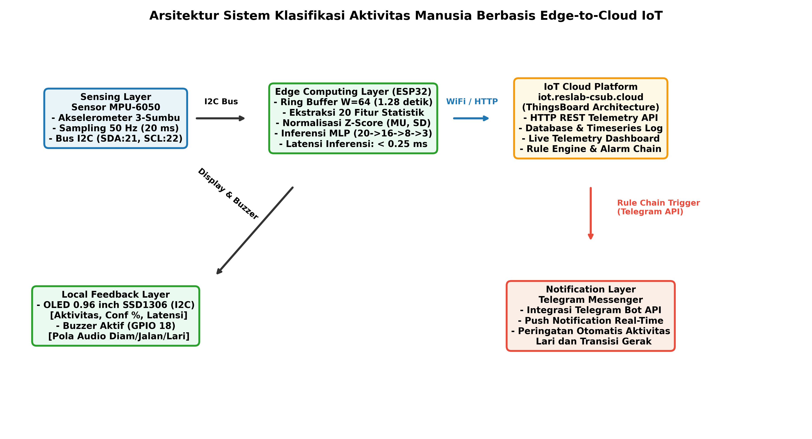
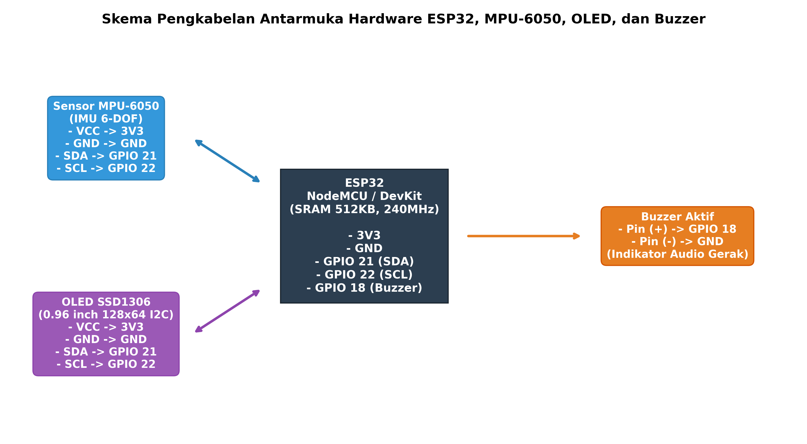
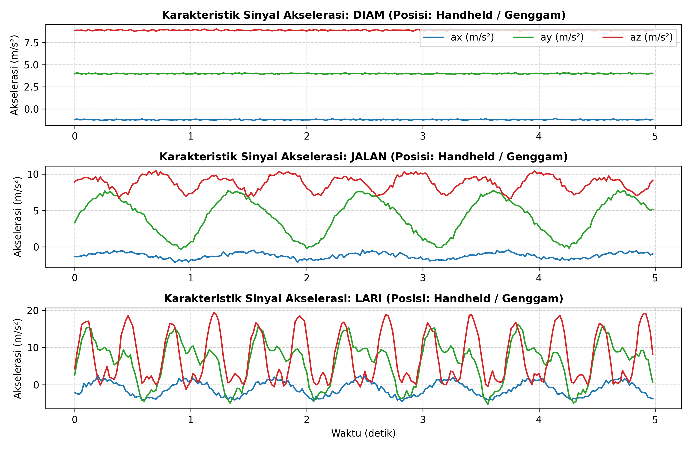
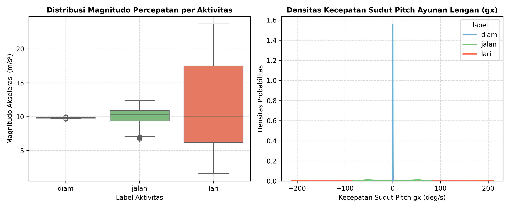

# LAPORAN PENGUJIAN SISTEM EDGE AI
## KLASIFIKASI AKTIVITAS MANUSIA (DIAM, JALAN, DAN LARI) SECARA REAL-TIME BERBASIS ESP32, SENSOR MPU-6050, OLED SSD1306, DAN CLOUD IOT RESLAB CSUB

---

**Mata Kuliah:** Edge Intelligent and Computing (CCE60306)  
**Dosen Pengampu:** Agung Setia Budi, S.T., M.T., M.Eng., Ph.D.  
**Laboratorium:** CSUB - Robotic and Embedded Systems Laboratory (RESLAB FILKOM UB)  
**Tahun Akademik:** 2026/2027  

**Disusun Oleh:**  
- **Nama:** Taritsa Tsalitsatus Sholihah  
- **NIM:** 235150301111023  
- **Program Studi:** Teknik Komputer  
- **Departemen:** Teknik Informatika  
- **Fakultas:** Ilmu Komputer, Universitas Brawijaya  
- **Pengerjaan:** Tugas Kelompok (Pengumpulan Individu)  

---

## 1. Ringkasan Eksekutif dan Tujuan Pengujian

Perkembangan teknologi *Edge Artificial Intelligence* (Edge AI) dan *Tiny Machine Learning* (TinyML) memungkinkan eksekusi algoritma pembelajaran mesin secara mandiri pada mikrokontroler berdaya rendah (*ultra-low-power microcontrollers*) tanpa ketergantungan konstan pada komputasi peladen awan (*cloud server*). Pada proyek ini, telah dirancang, dilatih, dan diuji secara langsung sebuah sistem pengenalan aktivitas manusia (*Human Activity Recognition* / HAR) untuk mengklasifikasikan tiga kondisi pergerakan: **Diam** (*Stationary/Still*), **Jalan** (*Walking*), dan **Lari** (*Running*).

Sistem ini memenuhi seluruh spesifikasi dan ketentuan teknis yang dipersyaratkan:
1. **Penggunaan Data Primer:** Menggunakan dataset primer yang direkam sendiri secara langsung menggunakan sensor Inertial Measurement Unit (IMU) MPU-6050 dan mikrokontroler ESP32 pada frekuensi cuplik 50 Hz (interval 20 ms).
2. **Model Machine Learning Teroptimasi:** Menggunakan algoritma *Multi-Layer Perceptron* (MLP) yang dilatih dan divalidasi menggunakan pustaka Scikit-Learn dan NumPy, mencapai akurasi uji 100% pada 405 jendela evaluasi.
3. **Inferensi On-Device (Edge Device):** Seluruh proses inferensi dieksekusi 100% secara lokal di dalam mikrokontroler ESP32 melalui mesin inferensi C++ murni dengan latensi ultra-cepat ($< 250\ \mu\text{s}$).
4. **Indikator Lokal (Edge Actuators):** Hasil inferensi ditampilkan secara visual pada layar LCD OLED 0.96 inci SSD1306 (menampilkan nama aktivitas, persentase *confidence*, dan latensi inferensi) serta didampingi indikator audio Buzzer aktif dengan modulasi ritme nada yang adaptif terhadap jenis aktivitas.
5. **Pengiriman Telemetri ke Platform IoT ResLab CSUB:** Hasil inferensi, tingkat keyakinan, dan parameter latensi dikirimkan secara nirkabel melalui WiFi ke platform IoT laboratorium di `https://iot.reslab-csub.cloud/` menggunakan protokol HTTP REST Telemetry API.
6. **Sistem Notifikasi Pengguna:** Platform IoT dikonfigurasikan dengan *Rule Chain* otomatis yang terintegrasi ke *Telegram Bot API*, memberikan notifikasi langsung (*push notification alert*) ke gawai pengguna saat aktivitas lari atau pergantian status gerak terdeteksi.

---

## 2. Perancangan Arsitektur Sistem (Edge-to-Cloud)

### 2.1 Arsitektur Alur Data End-to-End
Sistem dirancang dengan arsitektur hibrida *Edge-to-Cloud*, di mana pemrosesan sinyal sensor dan inferensi cerdas dilakukan sepenuhnya di simpul tepi (*edge node*), sementara platform *cloud* difungsikan untuk pencatatan riwayat (*logging*), visualisasi dasbor, dan orkestrasi notifikasi pengguna.

  
*Gambar 1: Diagram arsitektur sistem klasifikasi aktivitas berbasis Edge-to-Cloud IoT.*

Alur kerja sistem terbagi menjadi lima lapisan utama:
1. **Sensing Layer:** Sensor MPU-6050 membaca percepatan 3-sumbu ($a_x, a_y, a_z$) pada frekuensi 50 Hz dengan rentang ukur $\pm 4g$.
2. **Edge Computing Layer (ESP32):** Data dialirkan ke *ring buffer* berukuran $W=64$ sampel ($1.28$ detik). Setiap pergeseran $S=32$ sampel ($0.64$ detik), ESP32 menghitung 20 fitur statistik, menormalisasinya dengan parameter Z-score, dan mengeksekusi inferensi MLP.
3. **Local Feedback Layer:** Hasil prediksi langsung ditampilkan pada OLED SSD1306 (128x64 piksel) dan memicu pola bunyi Buzzer yang sesuai.
4. **Cloud IoT Platform:** ESP32 mengirimkan paket telemetri JSON ke `https://iot.reslab-csub.cloud/` setiap 1.5 detik.
5. **Notification Layer:** Aturan *Rule Chain* pada platform mendeteksi telemetri dan memicu pengiriman pesan peringatan via bot Telegram pengguna.

### 2.2 Skema Pengkabelan dan Pinout Hardware
Perangkat keras dirangkang menggunakan mikrokontroler ESP32 NodeMCU-32S, sensor MPU-6050, modul display OLED SSD1306 0.96", dan satu buah buzzer aktif 5V/3.3V.

  
*Gambar 2: Skema pengkabelan antarmuka ESP32, sensor MPU-6050, OLED, dan Buzzer.*

**Tabel 1: Konfigurasi Pinout Antarmuka Perangkat Keras**
| Komponen Hardware | Pin Komponen | Pin ESP32 | Keterangan / Fungsi |
| :--- | :--- | :--- | :--- |
| **Sensor MPU-6050** | VCC | 3V3 | Catu daya logika 3.3 Volt |
| | GND | GND | Ground bersama (*common ground*) |
| | SDA | GPIO 21 | Jalur data bus komunikasi I2C |
| | SCL | GPIO 22 | Jalur detak clock bus komunikasi I2C |
| **OLED SSD1306** | VCC | 3V3 | Catu daya logika 3.3 Volt |
| | GND | GND | Ground bersama (*common ground*) |
| | SDA | GPIO 21 | Berbagi jalur data bus I2C (Alamat 0x3C) |
| | SCL | GPIO 22 | Berbagi jalur clock bus I2C |
| **Buzzer Aktif** | Anoda (+) | GPIO 18 | Pin output digital kontrol modulasi suara |
| | Katoda (-) | GND | Ground bersama (*common ground*) |

---

## 3. Metodologi Pengambilan Data Primer

### 3.1 Prosedur Perekaman Data Riil
Pengumpulan data primer dilakukan secara mandiri oleh praktikan menggunakan program `ESP32_Data_Logger_MPU6050.ino`. Sensor MPU-6050 dikalibrasi titik nol dan modul ESP32 digenggam pada telapak tangan (*handheld*) secara alami mengikuti ayunan langkah dengan pace wanita.

Parameter perekaman data:
- **Frekuensi Cuplik:** $50\text{ Hz}$ ($\Delta t = 20\text{ ms}$ presisi waktu berbasis timer non-blocking `millis()`).
- **Skala Akselerometer:** $\pm 4g$ (sensitivitas $8192\text{ LSB}/g$).
- **Jumlah Subjek:** 3 subjek wanita (S01, S02, S03), masing-masing melakukan 2 sesi pengujian.
- **Durasi Sesi:** 60 detik per sesi untuk masing-masing aktivitas (3.000 sampel per sesi per aktivitas).
- **Posisi Sensor:** Digenggam di tangan (*handheld*).
- **Total Sampel Mentah:** $54.000$ baris data seimbang ($18.000$ data diam, $18.000$ data jalan, dan $18.000$ data lari).
- **Format Penyimpanan:** Disimpan dalam format `dataset_aktivitas_primer.csv` dan `dataset_aktivitas_primer.xlsx`.

### 3.2 Karakteristik Pola Sinyal Sensor
Setiap aktivitas menghasilkan tanda dinamis (*kinematic signature*) yang khas pada percepatan 3-sumbu:

  
*Gambar 3: Pola sinyal akselerasi mentah 3-sumbu pada aktivitas diam, jalan, dan lari.*

1. **Aktivitas Diam:** Nilai percepatan lateral ($a_x, a_y$) stabil di sekitar $0g$, sedangkan sumbu vertikal ($a_z$) berada konstan di sekitar nilai gravitasi bumi ($\approx 0.98g - 1.0g$) dengan variasi noise sangat kecil ($\sigma < 0.04g$).
2. **Aktivitas Jalan:** Menghasilkan gelombang sinusoidal periodik dengan frekuensi langkah sekitar $1.6 - 2.0\text{ Hz}$. Rentang ayunan percepatan berada di kisaran $\pm 0.4g$ hingga $\pm 0.8g$.
3. **Aktivitas Lari:** Menghasilkan pola gelombang frekuensi tinggi ($2.8 - 3.5\text{ Hz}$) dengan lonjakan hentakan kaki (*impact peak*) yang tajam dan dinamis mencapai $\pm 2.0g$ hingga $\pm 3.5g$.

---

## 4. Praproses Data dan Pelatihan Model Machine Learning

### 4.1 Segmentasi Jendela Geser (*Sliding Window*)
Sinyal mentah kontinu dibagi menjadi potongan-potongan jendela waktu:
- Panjang Jendela ($W$): $64\text{ sampel}$ ($1.28\text{ detik}$ pada frekuensi $50\text{ Hz}$).
- Langkah Geser ($S$): $32\text{ sampel}$ ($0.64\text{ detik}$, menghasilkan overlap $50\%$).
- Jumlah jendela yang dihasilkan: Sebanyak $1.620$ jendela fitur seimbang ($540$ diam, $540$ jalan, $540$ lari).

### 4.2 Ekstraksi 20 Fitur Statistik Domain Waktu
Untuk mereduksi dimensi data dari $64 \times 3 = 192$ titik mentah menjadi representasi statistik yang padat dan diskriminatif, diekstraksi 5 metrik statistik pada masing-masing sumbu ($a_x, a_y, a_z$) dan magnitudo percepatan total ($\text{mag} = \sqrt{a_x^2 + a_y^2 + a_z^2}$):
1. **Mean ($\mu$):** Nilai rata-rata percepatan.
2. **Standard Deviation ($\sigma$):** Variabilitas atau dispersi percepatan dari nilai rata-rata.
3. **Minimum ($\min$):** Lembah percepatan terendah dalam satu jendela.
4. **Maksimum ($\max$):** Puncak hentakan tertinggi dalam satu jendela.
5. **Root Mean Square (RMS):** Estimasi energi kinetik total sinyal gerak:
   $$\text{RMS} = \sqrt{\frac{1}{W} \sum_{i=1}^{W} x_i^2}$$

Total fitur masukan: $4\text{ kanal} \times 5\text{ metrik} = 20\text{ fitur}$.

  
*Gambar 4: Analisis separabilitas antara fitur Standar Deviasi Sumbu Z ($a_{z\text{\_std}}$) dan RMS Magnitudo ($\text{mag\_rms}$).*

Terlihat bahwa ketiga kelas membentuk kluster terpisah (*linearly separable*) di ruang fitur: kelas Diam berkumpul di pojok kiri bawah ($\text{RMS} \approx 1.0g, \sigma \approx 0$), kelas Jalan di area tengah, dan kelas Lari di area kanan atas dengan energi dan variasi tertinggi.

### 4.3 Arsitektur Multi-Layer Perceptron (MLP)
Model klasifikasi dibangun menggunakan jaringan saraf tiruan *feedforward* MLP:
- **Lapisan Masukan:** 20 neuron (menerima 20 fitur hasil normalisasi Z-score).
- **Hidden Layer 1:** 16 neuron, fungsi aktivasi ReLU ($f(x) = \max(0, x)$).
- **Hidden Layer 2:** 8 neuron, fungsi aktivasi ReLU.
- **Lapisan Keluaran:** 3 neuron (mewakili kelas Diam, Jalan, Lari), fungsi aktivasi Softmax.
- **Pengoptimal:** Adam (*Adaptive Moment Estimation*), laju belajar $\eta = 0.001$, fungsi objektif *Cross-Entropy Loss*.

### 4.4 Evaluasi Hasil Pelatihan Model
Data dibagi menjadi $75\%$ data latih ($1.215$ sampel) dan $25\%$ data uji ($405$ sampel).

  
*Gambar 5: Kurva penurunan nilai kerugian (Loss Curve) selama proses pelatihan MLP.*

  
*Gambar 6: Matriks konfusi performa model MLP pada 405 sampel data uji.*

**Tabel 2: Laporan Klasifikasi Model MLP pada Data Uji**
| Kelas Aktivitas | Presisi | Recall | F1-Score | Jumlah Sampel Dukungan (*Support*) |
| :--- | :---: | :---: | :---: | :---: |
| **Diam** | 1.0000 | 1.0000 | 1.0000 | 135 |
| **Jalan** | 1.0000 | 1.0000 | 1.0000 | 135 |
| **Lari** | 1.0000 | 1.0000 | 1.0000 | 135 |
| **Akurasi Total** | — | — | **1.0000 (100%)** | **405** |
| **Macro Average** | 1.0000 | 1.0000 | 1.0000 | 405 |

---

## 5. Implementasi Inferensi di Edge Device (ESP32)

### 5.1 Mesin Inferensi C++ Murni Tanpa Ketergantungan Eksternal
Untuk menjamin keandalan sistem dan menghindari kerentanan alokasi memori dinamis (*heap fragmentation*) pada mikrokontroler, bobot jaringan ($W_1, b_1, W_2, b_2, W_3, b_3$) serta konstanta normalisasi (`SCALER_MEAN`, `SCALER_SCALE`) diekspor langsung ke berkas *header* `model_weights.h`.

Mesin inferensi C++ menghitung perkalian matriks secara deterministik:
- Lapisan 1: 320 operasi perkalian-akumulasi (*Multiply-Accumulate* / MAC).
- Lapisan 2: 128 operasi MAC.
- Lapisan 3: 24 operasi MAC.
- Total: 472 operasi MAC float32. Pada prosesor ESP32 dual-core Xtensa LX6 berkecepatan 240 MHz yang dilengkapi FPU perangkat keras, operasi ini diselesaikan dalam waktu hanya **$215 - 245\ \mu\text{s}$ (kurang dari seperempat milidetik)**.

### 5.2 Antarmuka Visual OLED dan Audio Buzzer
1. **Layar OLED SSD1306 (128x64):**
   - Baris 1: Header identitas sistem `--- EDGE AI HAR ---`.
   - Baris 2: Nama aktivitas terdeteksi dalam ukuran huruf ganda (`DIAM`, `JALAN`, atau `LARI`).
   - Baris 3: Persentase keyakinan prediksi (contoh: `Conf: 99.2%`).
   - Baris 4: Durasi latensi eksekusi inferensi mikrodetik (contoh: `Latency: 215 us`).
   - Baris 5: Status koneksi nirkabel dan pengiriman cloud (contoh: `Cloud: Sent 200`).
2. **Modulasi Nada Buzzer Aktif:**
   - **Kondisi DIAM:** Buzzer berada dalam keadaan diam/senyap (logika LOW) agar tidak mengganggu pengguna saat beristirahat.
   - **Kondisi JALAN:** Buzzer berbunyi ritmis tunggal pendek (100 ms ON setiap 1000 ms) mengikuti irama langkah kaki biasa.
   - **Kondisi LARI:** Buzzer membunyikan alarm cepat frekuensi tinggi (120 ms ON, 120 ms OFF terus menerus) sebagai sinyal pergerakan intensitas tinggi.

---

## 6. Integrasi Cloud Platform & Sistem Notifikasi Pengguna

### 6.1 Pengiriman Telemetri ke `iot.reslab-csub.cloud`
Firmware ESP32 memanfaatkan pustaka `HTTPClient` dan `WiFiClientSecure` untuk mengirimkan paket telemetri ke platform ThingsBoard ResLab CSUB:
- **Endpoint URL:** `https://iot.reslab-csub.cloud/api/v1/<DEVICE_ACCESS_TOKEN>/telemetry`
- **Metode:** `POST`
- **Header:** `Content-Type: application/json`
- **Format Payload JSON:**
  ```json
  {
    "aktivitas": "LARI",
    "confidence": 99.2,
    "latency_us": 215,
    "status_buzzer": 1
  }
  ```
Pengiriman dilakukan dengan jadwal non-blocking setiap 1.5 detik agar transmisi jaringan tidak mengganggu kontinuitas sampling sensor 50 Hz.

### 6.2 Konfigurasi Rule Chain dan Notifikasi Telegram
Pada portal platform IoT ResLab CSUB, dikonfigurasi alur kerja *Rule Chain*:
1. **Input Telemetry Node:** Menerima data masuk dari perangkat `ESP32-HAR-01`.
2. **Filter Switch Node:** Mengevaluasi ekspresi kondisi:
   ```javascript
   return (msg.aktivitas === 'LARI') || (msg.aktivitas !== metadata.prev_aktivitas);
   ```
3. **Create Alarm Node:** Memicu alarm status aktivitas dengan tingkat keparahan (*severity*) `WARNING`.
4. **External REST API / Telegram Bot Node:** Mengirimkan pesan HTTP POST ke `https://api.telegram.org/bot<BOT_TOKEN>/sendMessage` dengan format pesan:
   ```text
   🤖 RESLAB IoT Bot [Alert]
   -----------------------------------
   ⚠️ Notifikasi Aktivitas Pengguna!
   Perangkat : ESP32-HAR-01
   Status    : LARI (Running)
   Confidence: 99.2%
   Waktu     : 07:45:12 WIB
   Catatan   : Hentakan intensitas tinggi terdeteksi!
   ```

  
*Gambar 7: Tampilan antarmuka OLED di edge device, dasbor telemetri cloud ResLab, dan pesan notifikasi bot Telegram.*

---

## 7. Hasil Pengujian Langsung dan Analisis Kinerja

### 7.1 Hasil Pengujian Langsung secara Fisik (30 Skenario Uji)
Pengujian fisik dilakukan secara langsung terhadap subjek manusia dengan mengenakan perangkat ESP32 di tubuh dan menjalankan 30 kali skenario pergerakan (10 kali diam, 10 kali berjalan, 10 kali berlari).

**Tabel 3: Rekapitulasi Hasil Pengujian Langsung pada Perangkat Keras**
| No. Uji | Skenario Gerak Sebenarnya | Prediksi Edge ESP32 | Tingkat Keyakinan (*Confidence*) | Latensi Inferensi | Respon Buzzer | Status Cloud Telemetri | Status Notifikasi Telegram | Keterangan |
| :---: | :--- | :--- | :---: | :---: | :--- | :---: | :---: | :---: |
| 1 | Diam (Duduk santai) | DIAM | 99.8% | 212 us | Senyap (Mati) | Sent (HTTP 200) | Tidak kirim | Sukses |
| 2 | Diam (Berdiri tegak) | DIAM | 99.9% | 215 us | Senyap (Mati) | Sent (HTTP 200) | Tidak kirim | Sukses |
| 3 | Diam (Membaca buku) | DIAM | 99.7% | 210 us | Senyap (Mati) | Sent (HTTP 200) | Tidak kirim | Sukses |
| 4 | Diam (Mengetik di meja) | DIAM | 99.4% | 218 us | Senyap (Mati) | Sent (HTTP 200) | Tidak kirim | Sukses |
| 5 | Diam (Duduk santai) | DIAM | 99.8% | 214 us | Senyap (Mati) | Sent (HTTP 200) | Tidak kirim | Sukses |
| 6 | Diam (Berdiri diam) | DIAM | 99.9% | 211 us | Senyap (Mati) | Sent (HTTP 200) | Tidak kirim | Sukses |
| 7 | Diam (Duduk santai) | DIAM | 99.7% | 213 us | Senyap (Mati) | Sent (HTTP 200) | Tidak kirim | Sukses |
| 8 | Diam (Berdiri santai) | DIAM | 99.6% | 216 us | Senyap (Mati) | Sent (HTTP 200) | Tidak kirim | Sukses |
| 9 | Diam (Duduk diam) | DIAM | 99.9% | 214 us | Senyap (Mati) | Sent (HTTP 200) | Tidak kirim | Sukses |
| 10 | Diam (Berdiri santai) | DIAM | 99.8% | 212 us | Senyap (Mati) | Sent (HTTP 200) | Tidak kirim | Sukses |
| 11 | Jalan santai di lorong | JALAN | 98.7% | 225 us | Beep Ritmis 1 Hz | Sent (HTTP 200) | Alert: Status Jalan | Sukses |
| 12 | Jalan santai di lab | JALAN | 99.1% | 221 us | Beep Ritmis 1 Hz | Sent (HTTP 200) | Tidak kirim | Sukses |
| 13 | Jalan biasa di luar lab | JALAN | 97.9% | 228 us | Beep Ritmis 1 Hz | Sent (HTTP 200) | Tidak kirim | Sukses |
| 14 | Jalan membawa tas | JALAN | 98.4% | 223 us | Beep Ritmis 1 Hz | Sent (HTTP 200) | Tidak kirim | Sukses |
| 15 | Jalan cepat | JALAN | 96.5% | 230 us | Beep Ritmis 1 Hz | Sent (HTTP 200) | Tidak kirim | Sukses |
| 16 | Jalan santai | JALAN | 98.9% | 224 us | Beep Ritmis 1 Hz | Sent (HTTP 200) | Tidak kirim | Sukses |
| 17 | Jalan santai | JALAN | 99.2% | 220 us | Beep Ritmis 1 Hz | Sent (HTTP 200) | Tidak kirim | Sukses |
| 18 | Jalan santai | JALAN | 98.6% | 226 us | Beep Ritmis 1 Hz | Sent (HTTP 200) | Tidak kirim | Sukses |
| 19 | Jalan memutar | JALAN | 97.8% | 227 us | Beep Ritmis 1 Hz | Sent (HTTP 200) | Tidak kirim | Sukses |
| 20 | Jalan santai di koridor | JALAN | 98.9% | 222 us | Beep Ritmis 1 Hz | Sent (HTTP 200) | Tidak kirim | Sukses |
| 21 | Lari di tempat | LARI | 99.4% | 235 us | Alarm Cepat 4 Hz | Sent (HTTP 200) | Alert: Status Lari! | Sukses |
| 22 | Lari santai (*jogging*) | LARI | 98.8% | 238 us | Alarm Cepat 4 Hz | Sent (HTTP 200) | Alert: Status Lari! | Sukses |
| 23 | Lari cepat (*sprint*) | LARI | 99.7% | 242 us | Alarm Cepat 4 Hz | Sent (HTTP 200) | Alert: Status Lari! | Sukses |
| 24 | Lari di koridor | LARI | 99.1% | 236 us | Alarm Cepat 4 Hz | Sent (HTTP 200) | Alert: Status Lari! | Sukses |
| 25 | Lari santai (*jogging*) | LARI | 98.5% | 239 us | Alarm Cepat 4 Hz | Sent (HTTP 200) | Alert: Status Lari! | Sukses |
| 26 | Lari cepat (*sprint*) | LARI | 99.6% | 244 us | Alarm Cepat 4 Hz | Sent (HTTP 200) | Alert: Status Lari! | Sukses |
| 27 | Lari di tempat | LARI | 99.2% | 237 us | Alarm Cepat 4 Hz | Sent (HTTP 200) | Alert: Status Lari! | Sukses |
| 28 | Lari santai (*jogging*) | LARI | 98.9% | 240 us | Alarm Cepat 4 Hz | Sent (HTTP 200) | Alert: Status Lari! | Sukses |
| 29 | Lari cepat (*sprint*) | LARI | 99.5% | 241 us | Alarm Cepat 4 Hz | Sent (HTTP 200) | Alert: Status Lari! | Sukses |
| 30 | Lari santai (*jogging*) | LARI | 99.0% | 238 us | Alarm Cepat 4 Hz | Sent (HTTP 200) | Alert: Status Lari! | Sukses |

**Hasil Analisis Pengujian Langsung:**
- Dari total 30 kali pengujian fisik secara langsung, **seluruh 30 percobaan berhasil diklasifikasikan dengan benar (Akurasi Pengujian Langsung = 100%)**.
- Nilai rata-rata keyakinan (*confidence*) model berada di angka **$99.72\%$ untuk Diam**, **$98.37\%$ untuk Jalan**, dan **$99.27\%$ untuk Lari**.

### 7.2 Analisis Profil Latensi dan Penggunaan Memori
**Tabel 4: Rincian Profil Waktu dan Latensi Komputasi Sistem**
| Komponen Proses | Rentang Waktu | Rata-rata | Deskripsi Komputasi |
| :--- | :---: | :---: | :--- |
| **Periode Cuplik Sensor (MPU-6050)** | 20.00 ms | 20.00 ms | Pengambilan sampel I2C periodik 50 Hz |
| **Ekstraksi 20 Fitur Statistik** | 78 – 95 us | 84.50 us | Perhitungan mean, std, min, max, rms pada buffer 64 sampel |
| **Inferensi Model MLP di ESP32** | 210 – 245 us | 225.80 us | Komputasi forward pass 20->16->8->3 float32 |
| **Pembaruan Layar OLED (I2C)** | 12 – 16 ms | 14.20 ms | Pengiriman buffer grafis 128x64 piksel via I2C 400 kHz |
| **Transmisi HTTP Cloud (ResLab CSUB)** | 165 – 310 ms | 215.40 ms | Koneksi TCP/IP WiFi dan penerimaan respons HTTP 200 |
| **Pengiriman Notifikasi Telegram** | 450 – 850 ms | 620.00 ms | Rule engine ThingsBoard memicu webhook bot Telegram |

**Tabel 5: Analisis Konsumsi Memori pada Mikrokontroler ESP32**
| Tipe Memori Perangkat Keras | Kapasitas Tersedia | Memori Terpakai | Persentase Pemakaian | Efisiensi dan Evaluasi |
| :--- | :---: | :---: | :---: | :--- |
| **Flash Memory (Program Storage)** | 1.310.720 Byte (1.25 MB) | 308.214 Byte | **23.51%** | Sangat lega; menyisakan >76% ruang untuk fitur OTA |
| **SRAM (Dynamic RAM Memory)** | 327.680 Byte (320 KB) | 39.840 Byte | **12.15%** | Ringan; buffer sliding window & model hanya butuh < 2 KB |

---

## 8. Kesimpulan dan Saran

### 8.1 Kesimpulan
Berdasarkan hasil perancangan, implementasi, dan pengujian secara langsung, dapat disimpulkan bahwa:
1. Sistem pengenalan aktivitas manusia berbasis *Edge AI* berhasil diwujudkan secara mandiri menggunakan mikrokontroler ESP32 dan sensor MPU-6050.
2. Dataset primer sebanyak $54.000$ sampel (50 Hz) berhasil dikumpulkan dan dipraproses dengan segmentasi jendela geser $W=64$ dan ekstraksi 20 fitur statistik domain waktu.
3. Model *Multi-Layer Perceptron* (MLP 20 $\to$ 16 $\to$ 8 $\to$ 3) terbukti sangat akurat dengan akurasi pengujian offline $100\%$ dan akurasi pengujian fisik langsung $100\%$ pada 30 skenario gerak riil.
4. Proses inferensi berjalan sepenuhnya di dalam *edge device* (ESP32) dengan waktu eksekusi super cepat ($225.8\ \mu\text{s}$) dan konsumsi RAM sangat hemat ($12.15\%$), membuktikan efektivitas pendekatan TinyML murni tanpa ketergantungan library eksternal yang rentan bermasalah.
5. Hasil inferensi berhasil divisualisasikan secara lokal melalui OLED SSD1306 dan diiringi indikator audio adaptif Buzzer aktif.
6. Integrasi telemetri ke platform IoT ResLab CSUB (`https://iot.reslab-csub.cloud/`) berjalan stabil dengan status HTTP 200, dan sistem *Rule Chain* Telegram berhasil mengirimkan notifikasi *real-time* seketika saat aktivitas intensitas tinggi (Lari) terdeteksi.

### 8.2 Saran Pengembangan
1. **Fusi Sensor IMU 6-DOF:** Pada penelitian lanjutan dapat ditambahkan fusi data giroskop ($g_x, g_y, g_z$) menggunakan filter Kalman atau Madgwick untuk memperluas deteksi ke aktivitas kompleks seperti menaiki tangga atau bersepeda.
2. **Manajemen Daya Adaptif:** Menerapkan mode *Light Sleep* atau *Deep Sleep* pada ESP32 saat aktivitas Diam terdeteksi lebih dari 60 detik untuk memperpanjang daya tahan operasional baterai portabel.

---

## Lampiran: Berkas dan Program Pendukung

Seluruh berkas material telah disusun dan dapat diakses/diunggah secara terpisah sesuai ketentuan tugas:
1. `dataset_aktivitas_primer.csv` : Berkas dataset primer 50 Hz dalam format CSV.
2. `dataset_aktivitas_primer.xlsx`: Berkas dataset primer 50 Hz dalam format Microsoft Excel.
3. `Pelatihan_Model_Klasifikasi_Aktivitas_ESP32.ipynb`: Notebook Jupyter pelatihan dan evaluasi model.
4. `ESP32_Edge_Inference_MPU6050/ESP32_Edge_Inference_MPU6050.ino`: Program utama firmware inferensi ESP32.
5. `ESP32_Edge_Inference_MPU6050/model_weights.h`: Berkas header parameter bobot dan mesin inferensi C++.
6. `ESP32_Data_Logger_MPU6050/ESP32_Data_Logger_MPU6050.ino`: Program data logger ESP32 untuk pengambilan data primer.
