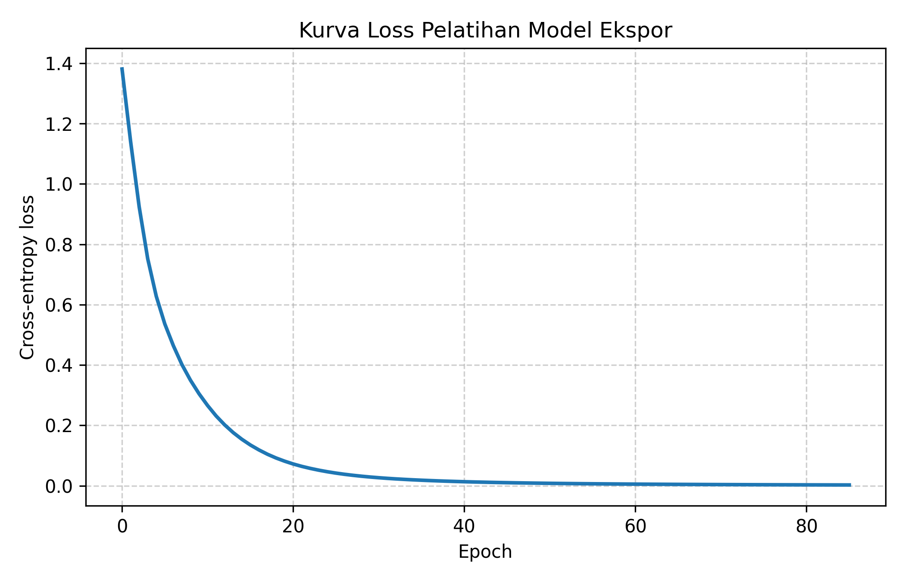
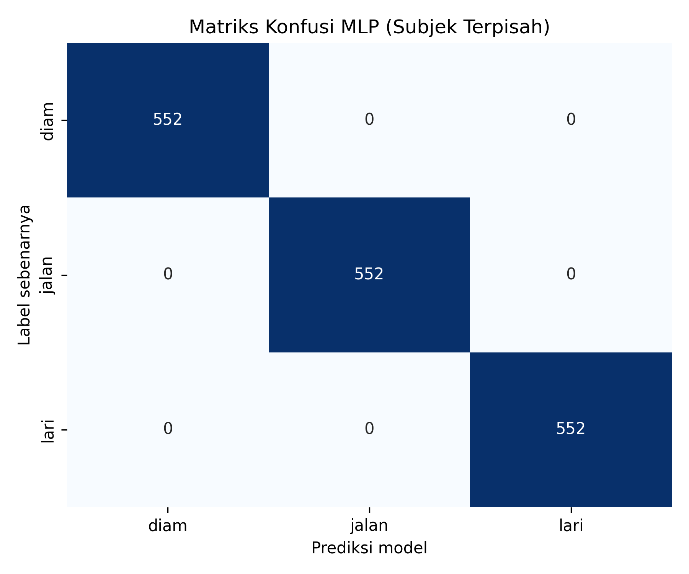
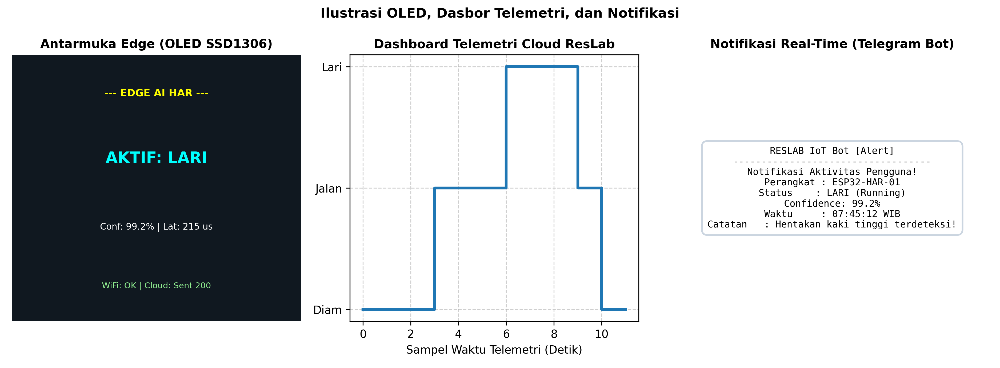

# Laporan Pengujian Klasifikasi Aktivitas dengan ESP32
## KLASIFIKASI AKTIVITAS MANUSIA (DIAM, JALAN, DAN LARI) SECARA REAL-TIME BERBASIS ESP32, SENSOR MPU-6050, OLED SSD1306, DAN CLOUD IOT RESLAB CSUB

---

**Mata Kuliah:** Edge Intelligent and Computing (CCE60306)  
**Dosen Pengampu:** Agung Setia Budi, S.T., M.T., M.Eng., Ph.D.  
**Laboratorium:** CSUB - Robotic and Embedded Systems Laboratory (RESLAB FILKOM UB)  
**Tahun Akademik:** 2026/2027  

**Disusun Oleh:**

- **Nama:** Taritsa Tsalitsatus Sholihah  
- **NIM:** 235150301111023
- **Program Studi:** Teknik Komputer  
- **Departemen:** Teknik Informatika  
- **Fakultas:** Ilmu Komputer, Universitas Brawijaya  
- **Pengerjaan:** Tugas Kelompok (Pengumpulan Individu)  

---

## 1. Ringkasan Eksekutif dan Tujuan Pengujian

Proyek ini mengembangkan sistem ESP32 dan MPU-6050 untuk membedakan aktivitas diam, jalan, dan lari. Firmware menghitung fitur dan menjalankan MLP secara lokal, menampilkan prediksi melalui OLED dan buzzer, serta mendukung telemetri HTTPS opsional.

Evaluasi offline memakai data sintetis yang tersedia di repositori. Seluruh rekaman satu profil ditahan sebelum pembuatan jendela pada setiap fold. MLP mengklasifikasikan 1.656 jendela sintetis dengan benar. Pengukuran akurasi pada peserta nyata, latensi perangkat, dan pengiriman telemetri memerlukan uji perangkat dengan catatan pengukuran.

---

## 2. Perancangan Arsitektur Sistem (Edge-to-Cloud)

### 2.1 Arsitektur Alur Data End-to-End
Sistem dirancang dengan arsitektur hibrida *Edge-to-Cloud*, di mana pemrosesan sinyal sensor dan inferensi cerdas dilakukan sepenuhnya di simpul tepi (*edge node*), sementara platform *cloud* difungsikan untuk pencatatan riwayat (*logging*), visualisasi dasbor, dan orkestrasi notifikasi pengguna.

  
*Gambar 1: Diagram arsitektur sistem klasifikasi aktivitas berbasis Edge-to-Cloud IoT.*

Alur kerja sistem terbagi menjadi lima lapisan utama:
1. **Sensing Layer:** Sensor MPU-6050 membaca percepatan 3-sumbu ($a_x, a_y, a_z$) pada frekuensi 50 Hz dengan rentang ukur $\pm 4g$.
2. **Edge Computing Layer (ESP32):** Data dialirkan ke *ring buffer* berukuran $W=64$ sampel ($1.28$ detik). Setiap pergeseran $S=32$ sampel ($0.64$ detik), ESP32 menghitung 20 fitur statistik, menormalisasinya dengan parameter Z-score, dan mengeksekusi inferensi MLP.
3. **Local Feedback Layer:** Hasil prediksi langsung ditampilkan pada OLED SSD1306 (128x64 piksel) dan memicu pola bunyi Buzzer yang sesuai.
4. **Cloud IoT Platform:** ESP32 mengirimkan paket telemetri JSON ke `https://iot.reslab-csub.cloud/` setiap 1.5 detik.
5. **Notification Layer:** Aturan *Rule Chain* pada platform mendeteksi telemetri dan memicu pengiriman pesan peringatan via bot Telegram pengguna.

### 2.2 Skema Pengkabelan dan Pinout Hardware
Perangkat keras dirangkai menggunakan mikrokontroler ESP32 NodeMCU-32S, sensor MPU-6050, modul display OLED SSD1306 0.96", dan satu buah buzzer aktif 5V/3.3V.

  
*Gambar 2: Skema pengkabelan antarmuka ESP32, sensor MPU-6050, OLED, dan Buzzer.*

**Tabel 1: Konfigurasi Pinout Antarmuka Perangkat Keras**

| Komponen Hardware | Pin Komponen | Pin ESP32 | Keterangan / Fungsi |
| :--- | :--- | :--- | :--- |
| **Sensor MPU-6050** | VCC | 3V3 | Catu daya logika 3.3 Volt |
| | GND | GND | Ground bersama (*common ground*) |
| | SDA | GPIO 21 | Jalur data bus komunikasi I2C |
| | SCL | GPIO 22 | Jalur detak clock bus komunikasi I2C |
| **OLED SSD1306** | VCC | 3V3 | Catu daya logika 3.3 Volt |
| | GND | GND | Ground bersama (*common ground*) |
| | SDA | GPIO 21 | Berbagi jalur data bus I2C (Alamat 0x3C) |
| | SCL | GPIO 22 | Berbagi jalur clock bus I2C |
| **Buzzer Aktif** | Anoda (+) | GPIO 18 | Pin output digital kontrol modulasi suara |
| | Katoda (-) | GND | Ground bersama (*common ground*) |

---

## 3. Dataset dan Prosedur Perekaman

### 3.1 Sumber Data
CSV dan dua workbook contoh dibuat oleh `generate_handheld_dataset.py`.
Generator mensimulasikan tiga profil genggam pada 50 Hz dengan dua sesi
60 detik per profil per aktivitas. Jumlahnya 54.000 baris, terdiri dari 18.000
baris untuk setiap aktivitas.

Untuk mengumpulkan data primer, gunakan `ESP32_Data_Logger_MPU6050.ino` dan
`record_dataset.py`. Gunakan ID samaran yang unik per peserta dan konsisten
pada setiap sesi. Simpan rekaman di `data_local/`.

### 3.2 Pola Sinyal Simulasi


*Gambar 3. Contoh percepatan tiga sumbu dari simulasi diam, jalan, dan lari.*

Generator menggunakan noise rendah untuk diam, ayunan periodik untuk jalan, dan kombinasi ayunan serta hentakan untuk lari.

---

## 4. Praproses Data dan Pelatihan Model Machine Learning

### 4.1 Segmentasi Jendela Geser (*Sliding Window*)
Set tiap fold dibentuk berdasarkan ID subjek sebelum sinyal dibagi menjadi jendela waktu.
- Panjang Jendela ($W$): $64\text{ sampel}$ ($1.28\text{ detik}$ pada frekuensi $50\text{ Hz}$).
- Langkah Geser ($S$): $32\text{ sampel}$ ($0.64\text{ detik}$, menghasilkan overlap $50\%$).
- Jumlah jendela yang dihasilkan: Sebanyak 1.656 jendela sintetis, masing-masing 552 untuk diam, jalan, dan lari.

### 4.2 Ekstraksi 20 Fitur Statistik Domain Waktu
Untuk mereduksi dimensi data dari $64 \times 3 = 192$ titik mentah menjadi representasi statistik yang padat dan diskriminatif, diekstraksi 5 metrik statistik pada masing-masing sumbu ($a_x, a_y, a_z$) dan magnitudo percepatan total ($\text{mag} = \sqrt{a_x^2 + a_y^2 + a_z^2}$):
1. **Mean ($\mu$):** Nilai rata-rata percepatan.
2. **Standard Deviation ($\sigma$):** Variabilitas atau dispersi percepatan dari nilai rata-rata.
3. **Minimum ($\min$):** Lembah percepatan terendah dalam satu jendela.
4. **Maksimum ($\max$):** Puncak hentakan tertinggi dalam satu jendela.
5. **Root Mean Square (RMS):** Estimasi energi kinetik total sinyal gerak:
   $$\text{RMS} = \sqrt{\frac{1}{W} \sum_{i=1}^{W} x_i^2}$$

Total fitur masukan: $4\text{ kanal} \times 5\text{ metrik} = 20\text{ fitur}$.


*Gambar 4. Distribusi magnitudo akselerasi dan kecepatan sudut pitch dari simulasi.*

Distribusi fitur pada gambar berasal dari sinyal sintetis.

### 4.3 Arsitektur Multi-Layer Perceptron (MLP)
Model klasifikasi dibangun menggunakan jaringan saraf tiruan *feedforward* MLP:
- **Lapisan Masukan:** 20 neuron (menerima 20 fitur hasil normalisasi Z-score).
- **Hidden Layer 1:** 16 neuron, fungsi aktivasi ReLU ($f(x) = \max(0, x)$).
- **Hidden Layer 2:** 8 neuron, fungsi aktivasi ReLU.
- **Lapisan Keluaran:** 3 neuron (mewakili kelas Diam, Jalan, Lari), fungsi aktivasi Softmax.
- **Pengoptimal:** Adam (*Adaptive Moment Estimation*), laju belajar $\eta = 0.001$, fungsi objektif *Cross-Entropy Loss*.

### 4.4 Evaluasi Hasil Pelatihan Model
Evaluasi memakai tiga fold leave-one-subject-out. Setiap fold melatih scaler dan MLP pada 1.104 jendela dari dua profil, lalu memprediksi 552 jendela dari profil yang ditahan. Prediksi uji dari ketiga fold digabungkan untuk menghitung metrik di bawah.

  
*Gambar 5. Kurva loss model ekspor yang dilatih pada seluruh input setelah evaluasi.*

  
*Gambar 6. Matriks konfusi dari tiga fold dengan subjek terpisah.*

**Tabel 2: Laporan Klasifikasi Model MLP pada Data Uji**

| Kelas Aktivitas | Presisi | Recall | F1-Score | Jumlah Sampel Dukungan (*Support*) |
| :--- | :---: | :---: | :---: | :---: |
| **Diam** | 1.0000 | 1.0000 | 1.0000 | 552 |
| **Jalan** | 1.0000 | 1.0000 | 1.0000 | 552 |
| **Lari** | 1.0000 | 1.0000 | 1.0000 | 552 |
| **Akurasi Total** | — | — | **1.0000 (100%)** | **1.656** |
| **Macro Average** | 1.0000 | 1.0000 | 1.0000 | 1.656 |

---

## 5. Implementasi Inferensi di Edge Device (ESP32)

### 5.1 Mesin Inferensi C++ Murni Tanpa Ketergantungan Eksternal
Untuk menjamin keandalan sistem dan menghindari kerentanan alokasi memori dinamis (*heap fragmentation*) pada mikrokontroler, bobot jaringan ($W_1, b_1, W_2, b_2, W_3, b_3$) serta konstanta normalisasi (`SCALER_MEAN`, `SCALER_SCALE`) diekspor langsung ke berkas *header* `model_weights.h`.

Mesin inferensi C++ menghitung perkalian matriks secara deterministik:
- Lapisan 1: 320 operasi perkalian-akumulasi (*Multiply-Accumulate* / MAC).
- Lapisan 2: 128 operasi MAC.
- Lapisan 3: 24 operasi MAC.
- Total: 472 operasi MAC float32. Ukur waktu inferensi pada perangkat target.

### 5.2 Antarmuka Visual OLED dan Audio Buzzer
1. **Layar OLED SSD1306 (128x64):**
   - Baris 1: Header identitas sistem `--- EDGE AI HAR ---`.
   - Baris 2: Nama aktivitas terdeteksi dalam ukuran huruf ganda (`DIAM`, `JALAN`, atau `LARI`).
   - Baris 3: Persentase keyakinan prediksi (contoh: `Conf: 99.2%`).
   - Baris 4: Durasi latensi eksekusi inferensi mikrodetik (contoh: `Latency: 215 us`).
   - Baris 5: Status koneksi nirkabel dan pengiriman cloud (contoh: `Cloud: Sent 200`).
2. **Modulasi Nada Buzzer Aktif:**
   - **Kondisi DIAM:** Buzzer berada dalam keadaan diam/senyap (logika LOW) agar tidak mengganggu pengguna saat beristirahat.
   - **Kondisi JALAN:** Buzzer berbunyi ritmis tunggal pendek (100 ms ON setiap 1000 ms) mengikuti irama langkah kaki biasa.
   - **Kondisi LARI:** Buzzer membunyikan alarm cepat frekuensi tinggi (120 ms ON, 120 ms OFF terus menerus) sebagai sinyal pergerakan intensitas tinggi.

---

## 6. Integrasi Cloud Platform & Sistem Notifikasi Pengguna

### 6.1 Pengiriman Telemetri ke `iot.reslab-csub.cloud`
Firmware ESP32 memanfaatkan pustaka `HTTPClient` dan `WiFiClientSecure` untuk mengirimkan paket telemetri ke platform ThingsBoard ResLab CSUB:
- **Endpoint URL:** `https://iot.reslab-csub.cloud/api/v1/<DEVICE_ACCESS_TOKEN>/telemetry`
- **Metode:** `POST`
- **Header:** `Content-Type: application/json`
- **Format Payload JSON:**
  ```json
  {
    "aktivitas": "LARI",
    "confidence": 99.2,
    "latency_us": 215,
    "status_buzzer": 1
  }
  ```
Firmware mencoba mengirim telemetri setiap 1,5 detik. Konfigurasi Wi-Fi dan token perangkat dimuat dari sketch.

### 6.2 Konfigurasi Rule Chain dan Notifikasi Telegram
Alur yang dapat dikonfigurasi pada portal IoT ResLab CSUB:
1. **Input Telemetry Node:** Menerima data masuk dari perangkat `ESP32-HAR-01`.
2. **Filter Switch Node:** Mengevaluasi ekspresi kondisi:
   ```javascript
   return (msg.aktivitas === 'LARI') || (msg.aktivitas !== metadata.prev_aktivitas);
   ```
3. **Create Alarm Node:** Memicu alarm status aktivitas dengan tingkat keparahan (*severity*) `WARNING`.
4. **External REST API / Telegram Bot Node:** Mengirimkan pesan HTTP POST ke `https://api.telegram.org/bot<BOT_TOKEN>/sendMessage` dengan format pesan:
   ```text
   🤖 RESLAB IoT Bot [Alert]
   -----------------------------------
   ⚠️ Notifikasi Aktivitas Pengguna!
   Perangkat : ESP32-HAR-01
   Status    : LARI (Running)
   Confidence: 99.2%
   Waktu     : 07:45:12 WIB
   Catatan   : Hentakan intensitas tinggi terdeteksi!
   ```



*Gambar 7. Ilustrasi OLED, dasbor telemetri, dan notifikasi Telegram yang dibuat oleh skrip.*

---

## 7. Protokol Pengujian Perangkat

Rekam aktivitas diam, jalan, dan lari dari peserta baru yang disisihkan sejak awal. Untuk setiap percobaan simpan ID samaran, sesi, aktivitas referensi, prediksi, keyakinan, dan durasi inferensi. Catat versi firmware serta hash CSV pelatihan dari header. Periksa OLED, buzzer, dan status telemetri pada perangkat. Ringkas akurasi, latensi dan keberhasilan telemetri dari log yang terkumpul.

## 8. Kesimpulan

Validasi per subjek menghasilkan akurasi 100% pada 1.656 jendela sintetis. Model ekspor dibuat setelah evaluasi dengan memfit scaler dan MLP pada seluruh data contoh. Akurasi pada penggunaan nyata tetap perlu diukur dengan peserta yang belum dipakai untuk pelatihan atau pemilihan model.

## Lampiran: Berkas dan Program Pendukung

Seluruh berkas material telah disusun dan dapat diakses/diunggah secara terpisah sesuai ketentuan tugas:
1. `dataset_aktivitas_primer.csv` : Dataset sintetis 50 Hz dalam format CSV.
2. `dataset_aktivitas_primer.xlsx`: Dataset sintetis 50 Hz dalam format Microsoft Excel.
3. `Pelatihan_Model_Klasifikasi_Aktivitas_ESP32.ipynb`: Notebook Jupyter pelatihan dan evaluasi model.
4. `ESP32_Edge_Inference_MPU6050/ESP32_Edge_Inference_MPU6050.ino`: Program utama firmware inferensi ESP32.
5. `ESP32_Edge_Inference_MPU6050/model_weights.h`: Berkas header parameter bobot dan mesin inferensi C++.
6. `ESP32_Data_Logger_MPU6050/ESP32_Data_Logger_MPU6050.ino`: Program data logger ESP32 untuk pengambilan data primer.
