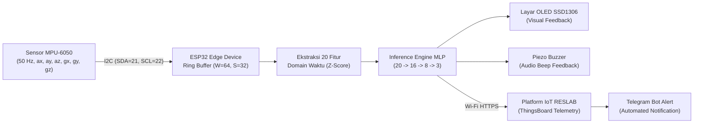
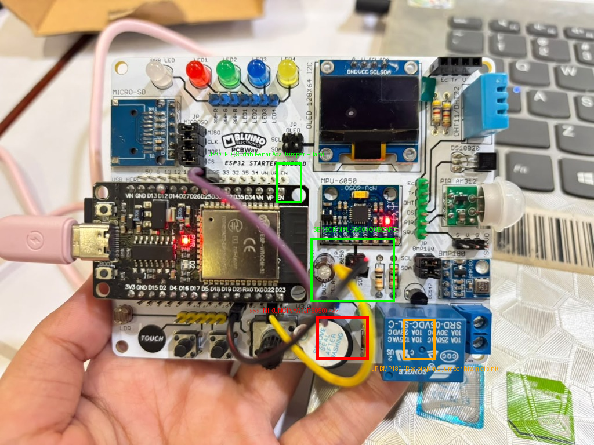

# Klasifikasi Aktivitas Manusia (HAR) Berbasis Edge AI pada ESP32 & Sensor MPU-6050

[-blue.svg)](https://www.espressif.com/)
[-orange.svg)](https://invensense.tdk.com/)
[-green.svg)](https://scikit-learn.org/)
[](https://iot.reslab-csub.cloud/)

> **Tugas Besar Mata Kuliah:** Edge Intelligent and Computing (CCE60306)  
> **Dosen Pengampu:** Agung Setia Budi, S.T., M.T., M.Eng., Ph.D.  
> **Laboratorium:** Robotic and Embedded Systems Laboratory (RESLAB - CSUB)  
> **Fakultas / Universitas:** Fakultas Ilmu Komputer, Universitas Brawijaya  
> **Penyusun:** Taritsa Tsalitsatus Sholihah (NIM: 235150301111023)

---

## 📌 Deskripsi Proyek
Proyek ini mengimplementasikan sistem **Human Activity Recognition (HAR)** mandiri untuk mengklasifikasikan tiga aktivitas manusia (**Diam**, **Jalan**, dan **Lari**) secara *real-time* langsung di dalam mikrokontroler (*on-device edge inference*).

Sistem menggunakan board **ESP32** dan modul sensor gerak **MPU-6050 (Akselerometer & Giroskop 6-DoF)**. Seluruh proses komputasi mulai dari *sliding window*, ekstraksi 20 fitur domain waktu, normalisasi Z-score, hingga evaluasi jaringan saraf tiruan (MLP) dieksekusi secara lokal di dalam ESP32 tanpa ketergantungan koneksi internet. Hasil klasifikasi ditampilkan secara visual pada layar **OLED SSD1306**, indikator audio adaptif melalui **Piezo Buzzer**, dan dikirimkan secara telemetri ke server **IoT RESLAB CSUB** melalui HTTPS jika telemetri dikonfigurasi.

---

## 📐 Arsitektur Sistem (End-to-End Edge AI)



---

## 📊 Dataset Demo Sintetis

`generate_handheld_dataset.py` membuat 54.000 baris sinyal sintetis pada 50 Hz.
Simulasi memakai tiga profil genggam dengan dua sesi per profil dan 3.000
sampel per aktivitas dalam setiap sesi. Nama berkas demo
[`dataset_aktivitas_primer.csv`](dataset_aktivitas_primer.csv) dan
[`dataset_aktivitas_primer.xlsx`](dataset_aktivitas_primer.xlsx) dipertahankan
agar perintah yang ada tetap berfungsi. Untuk evaluasi pada perangkat,
kumpulkan rekaman MPU-6050 dari peserta nyata.

### Distribusi Sampel:
| Profil simulasi | Sesi | Posisi | Diam (Sampel) | Jalan (Sampel) | Lari (Sampel) | Subtotal |
| :---: | :---: | :---: | :---: | :---: | :---: | :---: |
| **S01** | 1 & 2 | genggam | 6.000 | 6.000 | 6.000 | 18.000 |
| **S02** | 1 & 2 | genggam | 6.000 | 6.000 | 6.000 | 18.000 |
| **S03** | 1 & 2 | genggam | 6.000 | 6.000 | 6.000 | 18.000 |
| **TOTAL** | | | **18.000** | **18.000** | **18.000** | **54.000** |

---

## 🧠 Pipeline Pelatihan & Optimasi Machine Learning

Seluruh tahapan eksplorasi data, rekayasa fitur, dan pelatihan model terdokumentasi lengkap dan dapat direproduksi langsung pada notebook [`Pelatihan_Model_Klasifikasi_Aktivitas_ESP32.ipynb`](Pelatihan_Model_Klasifikasi_Aktivitas_ESP32.ipynb).

1. **Pemisahan subjek dan segmentasi jendela:** Setiap fold menahan seluruh rekaman satu subjek. Pipeline membentuk jendela secara terpisah di set latih dan set uji.
   * Ukuran Jendela ($W$): 64 sampel (1,28 detik pada 50 Hz).
   * Langkah Geser ($S$): 32 sampel (overlap 50%).
   * Total jendela fitur yang dihasilkan: **1.656 jendela data pada demo**.
2. **Ekstraksi 20 Fitur Statistik Domain Waktu:**
   Untuk setiap sumbu ($a_x, a_y, a_z$) dan magnitudo total ($|a| = \sqrt{a_x^2 + a_y^2 + a_z^2}$), diekstraksi 5 statistik:
   $$\text{Mean}, \quad \text{Standar Deviasi (Std)}, \quad \text{Minimum (Min)}, \quad \text{Maksimum (Max)}, \quad \text{Root Mean Square (RMS)}$$
   Total: $4 \text{ kanal} \times 5 \text{ metrik} = 20 \text{ fitur masukan}$.
3. **Standarisasi Z-Score:**
   $$Z = \frac{X - \mu}{\sigma}$$
   Scaler di-fit hanya pada data latih setiap fold. Parameter $\mu$ (*mean*) dan $\sigma$ (*scale*) disimpan ke C-header untuk memastikan praproses identik di ESP32.
4. **Arsitektur Model Jaringan Saraf (MLP):**
   * Lapisan Masukan: 20 neuron fitur.
   * Lapisan Tersembunyi 1: 16 neuron (Aktivasi ReLU).
   * Lapisan Tersembunyi 2: 8 neuron (Aktivasi ReLU).
   * Lapisan Keluaran: 3 neuron (Aktivasi Softmax: `DIAM`, `JALAN`, `LARI`).
5. **Evaluasi sintetis:** MLP mencapai akurasi 100% di tiga fold, masing-masing dengan 552 jendela dari subjek yang ditahan. Angka ini mengukur performa pada sinyal sintetis. Ukur akurasi penggunaan nyata dengan data MPU-6050 dari subjek baru.
6. **Ekspor:** Setelah evaluasi, MLP dilatih ulang dari seluruh input. Skrip mengekspor satu `model_weights.h` yang mencantumkan SHA-256 CSV pelatihan. Prediksi tiap fold menjadi dasar metrik evaluasi.

---

## 🛠️ Konfigurasi Hardware (Bluino ESP32 Starter Shield)

Perangkat keras menggunakan **Bluino Electronics ESP32 Starter Shield**:



### Jumper Header & Pinout Penting:
* **Sensor MPU-6050:**
  * Terhubung via jalur I2C default: **SDA = GPIO 21**, **SCL = GPIO 22**.
  * **PENTING:** Pasang 2 buah jumper cap pada pin header **`JP 6050`** (menjembatani baris SCL dan SDA) agar sensor terhubung ke ESP32.
* **Layar OLED SSD1306 (128x64 I2C):**
  * Terhubung pada bus I2C yang sama (**GPIO 21 & GPIO 22**, alamat I2C: `0x3C`).
  * Pastikan 2 buah jumper cap terpasang pada header **`JP OLED`**.
* **Piezo Buzzer:**
  * Terhubung ke pin **GPIO 25**.
* **LED Indikator Status:**
  * Terhubung ke pin **GPIO 26 / GPIO 13**.

---

## 📂 Struktur Direktori Proyek

```plaintext
TUGAS BESAR/
├── ESP32_Edge_Inference_MPU6050/       # Firmware utama Edge AI ESP32 (Inference + OLED + Buzzer + IoT)
│   ├── ESP32_Edge_Inference_MPU6050.ino
│   └── model_weights.h                 # Parameter bobot dan engine inferensi C++
├── ESP32_Data_Logger_MPU6050/          # Firmware untuk merekam data primer via Serial (50 Hz)
│   └── ESP32_Data_Logger_MPU6050.ino
├── ESP32_Standalone_Logger_SPIFFS/     # Firmware logger mandiri ke Flash internal ESP32
│   └── ESP32_Standalone_Logger_SPIFFS.ino
├── I2C_Scanner_ESP32/                  # Alat uji diagnostik alamat I2C modul
│   └── I2C_Scanner_ESP32.ino
├── images/                             # Gambar visualisasi sinyal, skema, diagram, dan foto alat
├── dataset_aktivitas_primer.csv        # Demo sintetis 54.000 sampel (CSV)
├── dataset_aktivitas_primer.xlsx       # Demo sintetis 54.000 sampel (Excel)
├── Pelatihan_Model_Klasifikasi_Aktivitas_ESP32.ipynb # Jupyter Notebook pelatihan dan evaluasi model
├── Laporan_Pengujian_Klasifikasi_Aktivitas_ESP32.pdf # Laporan evaluasi dan protokol uji fisik (PDF)
├── Laporan_Pengujian_Klasifikasi_Aktivitas_ESP32.docx# Laporan evaluasi dan protokol uji fisik (Word)
├── PANDUAN_STEP_BY_STEP_PERCOBAAN.pdf  # Panduan operasional langkah-demi-langkah (PDF)
├── PANDUAN_STEP_BY_STEP_PERCOBAAN.docx # Panduan operasional langkah-demi-langkah (Word)
├── record_dataset.py                   # Script Python untuk merekam data via Serial Port PC
├── train_and_export.py                 # Script otomasi retraining model & export C-header
└── README.md                           # Dokumentasi proyek GitHub
```

---

## 🚀 Panduan Penggunaan & Reproduksi

Instal dependensi Python untuk pelatihan dan perekaman dengan
`python -m pip install numpy pandas scikit-learn matplotlib seaborn pyserial openpyxl`.
Untuk menjalankan notebook, instal juga `jupyter`.

### 1. Perekaman Data Primer Mandiri (Opsional)
Jika ingin merekam data tambahan secara langsung:
```bash
# Upload ESP32_Data_Logger_MPU6050/ESP32_Data_Logger_MPU6050.ino via Arduino IDE
# Jalankan script perekam otomatis di terminal komputer:
python record_dataset.py
```
Masukkan ID peserta samaran yang sama untuk semua sesi orang tersebut dan ID berbeda
untuk setiap peserta lain. Pilih aktivitas dan durasi. Skrip menyimpan rekaman di
`data_local/rekaman_aktivitas.csv` dan membuat salinan Excel jika dependensinya tersedia.
Git mengabaikan folder `data_local/`.

Untuk mengecek sensor sebelum merekam, buka Serial Monitor di **115200 baud**.
Logger mencetak `# MPU_READY: 0x68` atau `0x69` saat sensor siap. Saat alat diam,
magnitudo akselerasi seharusnya sekitar `1 g`. Jika muncul `# MPU_ERROR`, periksa
kabel I²C, suplai, dan jumper `JP 6050` jika memakai shield. Tutup Serial Monitor
sebelum menjalankan `record_dataset.py`. Skrip mencatat hanya sampel valid.

### 2. Pelatihan Ulang Model (Retraining)
Buka dan jalankan seluruh sel pada notebook:
```bash
jupyter notebook Pelatihan_Model_Klasifikasi_Aktivitas_ESP32.ipynb
```
Atau jalankan skrip cepat melalui CLI:
```bash
python train_and_export.py
```
Perintah itu memperbarui [header bobot demo](ESP32_Edge_Inference_MPU6050/model_weights.h) di folder sketch. Untuk rekaman lokal, jalankan:

```bash
python train_and_export.py --dataset data_local/rekaman_aktivitas.csv
```

Artefak dari rekaman lokal tersimpan di `data_local/training/`. Untuk memasang
model hasil rekaman, gunakan header dari folder tersebut dalam salinan lokal
sketch inferensi. Rekam ketiga aktivitas pada beberapa subjek, dan sisihkan
peserta baru untuk uji akhir setelah memilih model.

Firmware logger menyimpan akselerasi dalam `g`, sementara CSV demo memakai
`m/s²`. Jika memakai CSV lain yang satuannya `m/s²`, tambahkan
`--accel-unit m/s2` saat mengekspor. Header bobot menyimpan faktor konversi
yang dipakai firmware.

### 3. Deployment & Inferensi pada ESP32
1. Buka Arduino IDE.
2. Pastikan pustaka berikut terpasang melalui Library Manager:
   * `Adafruit MPU6050` & `Adafruit BusIO`
   * `Adafruit SSD1306` & `Adafruit GFX Library`
   * `ArduinoJson` (v6.x)
3. Buka berkas [`ESP32_Edge_Inference_MPU6050/ESP32_Edge_Inference_MPU6050.ino`](ESP32_Edge_Inference_MPU6050/ESP32_Edge_Inference_MPU6050.ino).
4. Untuk telemetri, atur `WIFI_SSID`, `WIFI_PASSWORD`, dan `DEVICE_ACCESS_TOKEN` di sketch `ESP32_Edge_Inference_MPU6050.ino`.
5. Pilih board **ESP32 Dev Module**, tentukan port COM, lalu klik **Upload**.
6. Amati layar OLED pada modul:
   * Saat alat digenggam diam $\to$ OLED menampilkan **`DIAM`** (Buzzer senyap).
   * Saat berjalan dengan ayunan tangan normal $\to$ OLED menampilkan **`JALAN`** (Buzzer bip 1x).
   * Saat berlari/jogging dengan tempo cepat $\to$ OLED menampilkan **`LARI`** (Buzzer bip cepat 3x).

Jika OLED menunjukkan `IMU ERROR`, buka Serial Monitor pada **115200 baud**.
Firmware mencoba alamat I²C `0x68` dan `0x69` dan mencetak nilai akselerasi
dalam `g` setiap kali menghasilkan prediksi. Di posisi diam, magnitudo
akselerasi seharusnya sekitar `1 g`. Pastikan pin SDA/GPIO 21, SCL/GPIO 22,
VCC 3,3 V, GND, dan jumper `JP 6050` jika memakai shield.

### 4. Telemetri Cloud & Notifikasi Pengguna
1. Buka dashboard pada [https://iot.reslab-csub.cloud/](https://iot.reslab-csub.cloud/).
2. Data telemetri dikirimkan dalam format JSON:
   ```json
   {
     "aktivitas": "JALAN",
     "confidence": 99.8,
     "latency_us": 215,
     "status_buzzer": 1
   }
   ```
3. Konfigurasi Rule Chain ThingsBoard dengan *Telegram Node* untuk mengirimkan notifikasi otomatis ke bot pengguna saat aktivitas pengguna berganti atau saat aktivitas `LARI` terdeteksi.

### 5. Membuat ulang laporan dan panduan

Dari berkas Markdown, jalankan `python build_testing_report_docx.py` untuk
laporan dan `python build_testing_report_docx.py --guide` untuk panduan.
Keduanya menggunakan Pandoc dan `python-docx`. Skrip `convert_report_to_pdf.ps1`
dan `convert_panduan_to_pdf.ps1` memakai Word untuk ekspor PDF.

---

## 📄 Lisensi & Hak Cipta
Proyek ini dibuat untuk keperluan akademis mata kuliah **Edge Intelligent and Computing**, Fakultas Ilmu Komputer, Universitas Brawijaya. Bebas digunakan dan dikembangkan untuk keperluan riset dan edukasi dengan mencantumkan atribusi penulis.
