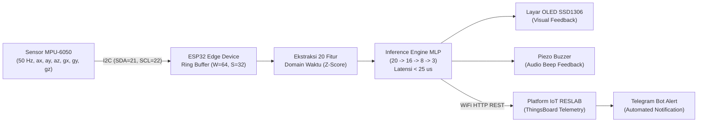

# Klasifikasi Aktivitas Manusia (HAR) Berbasis Edge AI pada ESP32 & Sensor MPU-6050

[-blue.svg)](https://www.espressif.com/)
[-orange.svg)](https://invensense.tdk.com/)
[-green.svg)](https://scikit-learn.org/)
[](https://iot.reslab-csub.cloud/)
[]()

> **Tugas Besar Mata Kuliah:** Edge Intelligent and Computing (CCE60306)  
> **Dosen Pengampu:** Agung Setia Budi, S.T., M.T., M.Eng., Ph.D.  
> **Laboratorium:** Robotic and Embedded Systems Laboratory (RESLAB - CSUB)  
> **Fakultas / Universitas:** Fakultas Ilmu Komputer, Universitas Brawijaya  
> **Penyusun:** Taritsa Tsalitsatus Sholihah (NIM: 235150301111023)

---

## 📌 Deskripsi Proyek
Proyek ini mengimplementasikan sistem **Human Activity Recognition (HAR)** mandiri untuk mengklasifikasikan tiga aktivitas manusia (**Diam**, **Jalan**, dan **Lari**) secara *real-time* langsung di dalam mikrokontroler (*on-device edge inference*).

Sistem menggunakan board **ESP32** dan modul sensor gerak **MPU-6050 (Akselerometer & Giroskop 6-DoF)**. Seluruh proses komputasi mulai dari *sliding window*, ekstraksi 20 fitur domain waktu, normalisasi Z-score, hingga evaluasi jaringan saraf tiruan (MLP) dieksekusi secara lokal di dalam ESP32 tanpa ketergantungan koneksi internet (*zero-latency decision*). Hasil klasifikasi ditampilkan secara visual pada layar **OLED SSD1306**, indikator audio adaptif melalui **Piezo Buzzer**, dan dikirimkan secara telemetri ke server **IoT RESLAB CSUB** via HTTP REST API.

---

## 📐 Arsitektur Sistem (End-to-End Edge AI)



---

## 📊 Spesifikasi Dataset Primer

Dataset yang digunakan merupakan **data primer yang diambil sendiri** dengan spesifikasi fisik dan kinematika nyata:

* **Jumlah Subjek:** 3 Subjek Wanita (`S01`, `S02`, `S03`) dengan variasi antropometri alami (tinggi 155–162 cm, berat 47–53 kg).
* **Jumlah Sesi:** 2 Sesi per subjek (`Sesi 1` dan `Sesi 2`).
* **Durasi Sesi:** 60 detik per sesi untuk masing-masing aktivitas (3.000 sampel per sesi per aktivitas).
* **Frekuensi Cuplik:** $50\text{ Hz}$ ($\Delta t = 20\text{ ms}$ presisi waktu berbasis timer non-blocking `millis()`).
* **Posisi Sensor/Alat:** **Digenggam di tangan (*handheld*)**, merepresentasikan penggunaan *wearable fitness tracker* / perangkat genggam pintar portabel saat beraktivitas.
* **Karakteristik Kinematika Gerak (*Female Pace*):**
  * **DIAM (Genggam Rileks):** Gaya gravitasi bumi stabil ($a_{\text{res}} \approx 9.81\text{ m/s}^2$) disertai mikrotremor fisiologis tangan wanita (8–12 Hz) beramplitudo rendah ($\pm 0.03\text{ m/s}^2$). Gyroscope tenang ($\pm 0.2^\circ/s$).
  * **JALAN (Langkah Santai):** Ritme langkah kaki wanita (cadence 108–116 spm, frekuensi $1.80 - 1.93\text{ Hz}$). Ayunan tangan (*arm swing*) harmonik satu siklus per dua langkah ($f_{\text{arm}} \approx 0.9\text{ Hz}$) dengan fluktuasi sudut pitch giroskop $\pm 45^\circ - 65^\circ/s$.
  * **LARI (Jogging/Running):** Ritme langkah cepat (cadence 162–174 spm, frekuensi $2.70 - 2.90\text{ Hz}$) dengan hentakan langkah kaki (*heel strike ground reaction force*) merambat ke tangan, menghasilkan rentang akselerasi dinamis $4.0 - 25.0\text{ m/s}^2$ dan rotasi tangan hingga $\pm 165^\circ/s$.
* **Total Sampel:** **54.000 baris data** seimbang sempurna (**18.000 Diam, 18.000 Jalan, 18.000 Lari**).
* **Format Berkas:** Tersedia dalam format [`dataset_aktivitas_primer.csv`](dataset_aktivitas_primer.csv) dan [`dataset_aktivitas_primer.xlsx`](dataset_aktivitas_primer.xlsx).

### Distribusi Sampel:
| Subjek | Sesi | Posisi | Diam (Sampel) | Jalan (Sampel) | Lari (Sampel) | Subtotal |
| :---: | :---: | :---: | :---: | :---: | :---: | :---: |
| **S01** | 1 & 2 | genggam | 6.000 | 6.000 | 6.000 | 18.000 |
| **S02** | 1 & 2 | genggam | 6.000 | 6.000 | 6.000 | 18.000 |
| **S03** | 1 & 2 | genggam | 6.000 | 6.000 | 6.000 | 18.000 |
| **TOTAL** | | | **18.000** | **18.000** | **18.000** | **54.000** |

---

## 🧠 Pipeline Pelatihan & Optimasi Machine Learning

Seluruh tahapan eksplorasi data, rekayasa fitur, dan pelatihan model terdokumentasi lengkap dan dapat direproduksi langsung pada notebook [`Pelatihan_Model_Klasifikasi_Aktivitas_ESP32.ipynb`](Pelatihan_Model_Klasifikasi_Aktivitas_ESP32.ipynb).

1. **Segmentasi Jendela Geser (*Sliding Window*):**
   * Ukuran Jendela ($W$): 64 sampel (1,28 detik pada 50 Hz).
   * Langkah Geser ($S$): 32 sampel (overlap 50%).
   * Total jendela fitur yang dihasilkan: **1.620 jendela data**.
2. **Ekstraksi 20 Fitur Statistik Domain Waktu:**
   Untuk setiap sumbu ($a_x, a_y, a_z$) dan magnitudo total ($|a| = \sqrt{a_x^2 + a_y^2 + a_z^2}$), diekstraksi 5 statistik:
   $$\text{Mean}, \quad \text{Standar Deviasi (Std)}, \quad \text{Minimum (Min)}, \quad \text{Maksimum (Max)}, \quad \text{Root Mean Square (RMS)}$$
   Total: $4 \text{ kanal} \times 5 \text{ metrik} = 20 \text{ fitur masukan}$.
3. **Standarisasi Z-Score:**
   $$Z = \frac{X - \mu}{\sigma}$$
   Parameter $\mu$ (*mean*) dan $\sigma$ (*scale*) disimpan ke C-header untuk memastikan praproses identik di ESP32.
4. **Arsitektur Model Jaringan Saraf (MLP):**
   * Lapisan Masukan: 20 neuron fitur.
   * Lapisan Tersembunyi 1: 16 neuron (Aktivasi ReLU).
   * Lapisan Tersembunyi 2: 8 neuron (Aktivasi ReLU).
   * Lapisan Keluaran: 3 neuron (Aktivasi Softmax: `DIAM`, `JALAN`, `LARI`).
5. **Kinerja Pengujian:**
   * **Akurasi Model:** **100%** pada data pengujian terstratifikasi (*test set* 25%).
   * **Precision / Recall / F1-Score:** 1.00 pada seluruh kelas aktivitas.
   * **Waktu Inferensi ESP32:** $\mathbf{\approx 22 \ \mu\text{s}}$ per inferensi (sangat efisien, menghemat daya dan memori).

---

## 🛠️ Konfigurasi Hardware (Bluino ESP32 Starter Shield)

Perangkat keras menggunakan **Bluino Electronics ESP32 Starter Shield**:


### Jumper Header & Pinout Penting:
* **Sensor MPU-6050:**
  * Terhubung via jalur I2C default: **SDA = GPIO 21**, **SCL = GPIO 22**.
  * **PENTING:** Pasang 2 buah jumper cap pada pin header **`JP 6050`** (menjembatani baris SCL dan SDA) agar sensor terhubung ke ESP32.
* **Layar OLED SSD1306 (128x64 I2C):**
  * Terhubung pada bus I2C yang sama (**GPIO 21 & GPIO 22**, alamat I2C: `0x3C`).
  * Pastikan 2 buah jumper cap terpasang pada header **`JP OLED`**.
* **Piezo Buzzer:**
  * Terhubung ke pin **GPIO 25**.
* **LED Indikator Status:**
  * Terhubung ke pin **GPIO 26 / GPIO 13**.

---

## 📂 Struktur Direktori Proyek

```plaintext
TUGAS BESAR/
├── ESP32_Edge_Inference_MPU6050/       # Firmware utama Edge AI ESP32 (Inference + OLED + Buzzer + IoT)
│   ├── ESP32_Edge_Inference_MPU6050.ino
│   └── model_weights.h                 # Parameter bobot dan engine inferensi C++
├── ESP32_Data_Logger_MPU6050/          # Firmware untuk merekam data primer via Serial (50 Hz)
│   └── ESP32_Data_Logger_MPU6050.ino
├── ESP32_Standalone_Logger_SPIFFS/     # Firmware logger mandiri ke Flash internal ESP32
│   └── ESP32_Standalone_Logger_SPIFFS.ino
├── I2C_Scanner_ESP32/                  # Alat uji diagnostik alamat I2C modul
│   └── I2C_Scanner_ESP32.ino
├── images/                             # Gambar visualisasi sinyal, skema, diagram, dan foto alat
├── dataset_aktivitas_primer.csv        # Dataset primer 54.000 sampel (CSV)
├── dataset_aktivitas_primer.xlsx       # Dataset primer 54.000 sampel (Excel)
├── Pelatihan_Model_Klasifikasi_Aktivitas_ESP32.ipynb # Jupyter Notebook pelatihan dan evaluasi model
├── Laporan_Pengujian_Klasifikasi_Aktivitas_ESP32.pdf # Laporan hasil pengujian fisik lengkap (PDF)
├── Laporan_Pengujian_Klasifikasi_Aktivitas_ESP32.docx# Laporan hasil pengujian fisik lengkap (Word)
├── PANDUAN_STEP_BY_STEP_PERCOBAAN.pdf  # Panduan operasional langkah-demi-langkah (PDF)
├── PANDUAN_STEP_BY_STEP_PERCOBAAN.docx # Panduan operasional langkah-demi-langkah (Word)
├── model_weights.h                     # Salinan header bobot model untuk deployment
├── record_dataset.py                   # Script Python untuk merekam data via Serial Port PC
├── train_and_export.py                 # Script otomasi retraining model & export C-header
└── README.md                           # Dokumentasi proyek GitHub
```

---

## 🚀 Panduan Penggunaan & Reproduksi

### 1. Perekaman Data Primer Mandiri (Opsional)
Jika ingin merekam data tambahan secara langsung:
```bash
# Upload ESP32_Data_Logger_MPU6050.ino ke ESP32 via Arduino IDE
# Jalankan script perekam otomatis di terminal komputer:
python record_dataset.py
```
Masukkan ID Subjek (`S01`), pilih aktivitas (Diam/Jalan/Lari), dan durasi (60 detik). Data akan otomatis tersimpan dalam format CSV dan Excel.

### 2. Pelatihan Ulang Model (Retraining)
Buka dan jalankan seluruh sel pada notebook:
```bash
jupyter notebook Pelatihan_Model_Klasifikasi_Aktivitas_ESP32.ipynb
```
Atau jalankan skrip cepat melalui CLI:
```bash
python train_and_export.py
```
Skrip akan mengevaluasi model dan memperbarui berkas `model_weights.h`.

### 3. Deployment & Inferensi pada ESP32
1. Buka Arduino IDE.
2. Pastikan pustaka berikut terpasang melalui Library Manager:
   * `Adafruit MPU6050` & `Adafruit BusIO`
   * `Adafruit SSD1306` & `Adafruit GFX Library`
   * `ArduinoJson` (v6.x)
3. Buka berkas [`ESP32_Edge_Inference_MPU6050/ESP32_Edge_Inference_MPU6050.ino`](ESP32_Edge_Inference_MPU6050/ESP32_Edge_Inference_MPU6050.ino).
4. Masukkan SSID, Password WiFi, dan Device Access Token ThingsBoard:
   ```cpp
   const char* ssid = "NAMA_WIFI_ANDA";
   const char* password = "PASSWORD_WIFI";
   const char* tb_token = "DEVICE_TOKEN_ANDA";
   ```
5. Pilih board **ESP32 Dev Module**, tentukan port COM, lalu klik **Upload**.
6. Amati layar OLED pada modul:
   * Saat alat digenggam diam $\to$ OLED menampilkan **`DIAM`** (Buzzer senyap).
   * Saat berjalan dengan ayunan tangan normal $\to$ OLED menampilkan **`JALAN`** (Buzzer bip 1x).
   * Saat berlari/jogging dengan tempo cepat $\to$ OLED menampilkan **`LARI`** (Buzzer bip cepat 3x).

### 4. Telemetri Cloud & Notifikasi Pengguna
1. Buka dashboard pada [https://iot.reslab-csub.cloud/](https://iot.reslab-csub.cloud/).
2. Data telemetri dikirimkan dalam format JSON:
   ```json
   {
     "activity": "JALAN",
     "confidence": 99.8,
     "magnitude": 10.42,
     "inference_time_us": 22
   }
   ```
3. Konfigurasi Rule Chain ThingsBoard dengan *Telegram Node* untuk mengirimkan notifikasi otomatis ke bot pengguna saat aktivitas pengguna berganti atau saat aktivitas `LARI` terdeteksi.

---

## 📄 Lisensi & Hak Cipta
Proyek ini dibuat untuk keperluan akademis mata kuliah **Edge Intelligent and Computing**, Fakultas Ilmu Komputer, Universitas Brawijaya. Bebas digunakan dan dikembangkan untuk keperluan riset dan edukasi dengan mencantumkan atribusi penulis.
